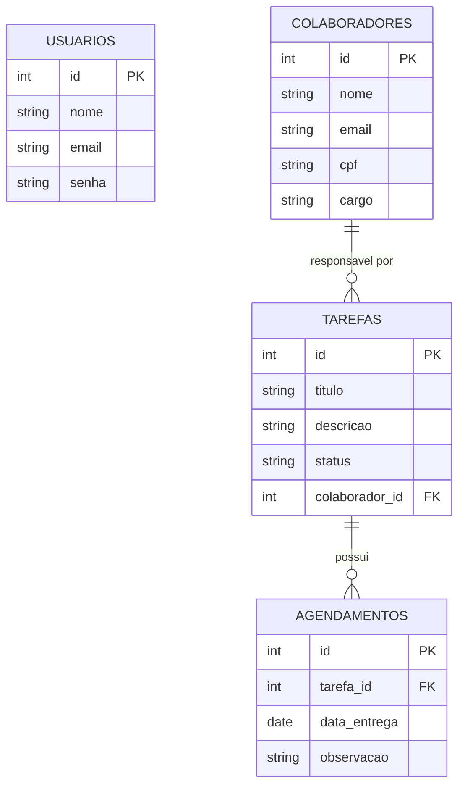

# Gestão e Agendamento de Tarefas

Stack: Node + Express + Prisma (MySQL) · React + Vite. Login com JWT (expira em 2h), senha com bcrypt, CPF com AES-256-GCM.

## Como rodar
1. `cp .env.example .env` e ajuste `DATABASE_URL`.
2. Importe `saep_db.sql` no MySQL (já cria e popula o banco). Usuário de teste: `ana@empresa.com` / `Senha@123`.
3. `npm install && npx prisma generate && npm run dev` (API em :3001).
4. `cd frontend && npm install && npm run dev` (app em :5173).

## Requisitos funcionais
- RF01 Login com mensagem de erro para credenciais inválidas e sessão com expiração.
- RF02 Painel com nome do usuário, navegação e logout.
- RF03 CRUD de colaboradores com busca (nome, e-mail, cargo); CPF criptografado e exibido mascarado.
- RF04 CRUD de tarefas, obrigatoriamente vinculadas a um colaborador existente.
- RF05 CRUD de agendamentos; listagem ordenada por data de entrega com dados da tarefa e do responsável.

## DER

